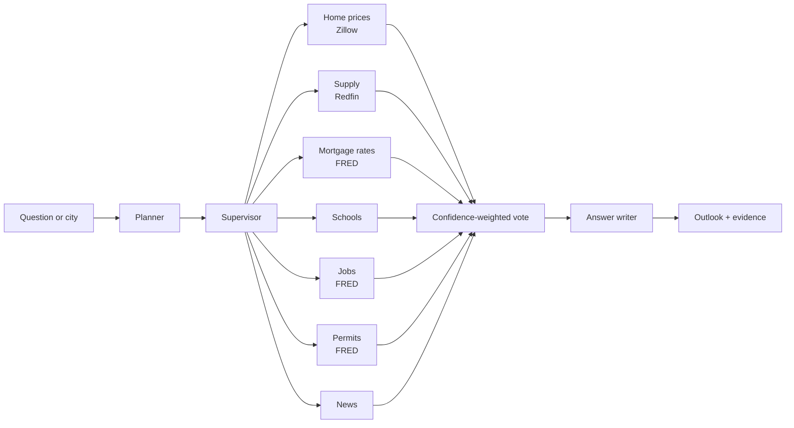

# RETrend

RETrend is a multi-agent system that reads public housing data and says which way home prices are likely to move in a U.S. city over the next 6 to 12 months: **up**, **down** or **flat**. A supervisor combines reports from specialist workers (home prices, supply, mortgage rates, schools, jobs, permits, news) into one outlook, with the evidence and the uncertainty shown next to it.

The design rule is **code for data, a language model for judgment**. Plain code fetches and measures; a model (optional, local or hosted) only reads the finished numbers, and every model reply is validated before it is used. Without any model the system runs on transparent rules.

It is a signals tool, not a forecaster. It does not give buy or sell advice, and its confidence figures are not calibrated.



Prices (0.5) and supply (0.5) vote. Mortgage rates, schools, jobs, permits and news are shown as context with weight 0, because the backtests found no gain from letting them vote. See [Backtest results](#backtest-results).

## Setup

Needs Python 3.11+ and a free [FRED API key](https://fred.stlouisfed.org/docs/api/api_key.html).

```
python -m venv .venv
.venv\Scripts\activate                 # macOS/Linux: source .venv/bin/activate
pip install -e ".[dev,llm]"
copy .env.example .env                 # macOS/Linux: cp .env.example .env
```

Open `.env` and set `FRED_API_KEY`. The key lives only in `.env` (which is git-ignored) or your environment. It is redacted from errors and never logged or stored in reports.

Check the key and the install:

```
retrend fred-check
python -m unittest discover -s tests
```

Local models (optional, no API key): install [Ollama](https://ollama.com), then pull the three models the project ships with:

```
ollama pull qwen3:4b-instruct
ollama pull llama3.2:1b
ollama pull gemma3:4b
```

They are registered in `config/models.yaml` as `qwen`, `llama` and `gemma`. Edit that file to use other tags (`ollama list` shows what you have). A hosted Groq model is shown commented out there; it needs `pip install -e ".[cloud]"` and `GROQ_API_KEY` in `.env`.

## Outlook for one city

```
retrend outlook seattle-wa
```

It prints the direction (up, down or flat), a score from -1 to +1, an uncalibrated confidence, what each signal said, which ones pulled the other way, and any signal that could not be fetched.

Add models and extra signals as needed:

```
retrend outlook seattle-wa --models qwen            # a local model judges each signal and writes the narrative
retrend outlook seattle-wa --with-jobs --with-permits --with-schools --with-news
retrend outlook seattle-wa --as-of 2023-06-30       # what the system would have said then
retrend outlook 98101                               # a ZIP code works anywhere a city does
```

City keys such as `seattle-wa` come from `config/test_cities.yaml` and `config/backtest_cities.yaml`; any other "City, ST" also works.

ZIP codes need a one-time download of the free GeoNames table:

```
retrend zip-fetch
```

## Web UI

```
retrend ui
```

This opens `http://127.0.0.1:8765` in your browser. It listens on your machine only.

| Tab | What it does |
|---|---|
| Ask RETrend | Type a question in plain language. Every question runs **all seven workers**, then the answer discusses each signal in turn and ends with an overall trend. A table of sample questions under the box covers every worker. |
| Home prices | Zillow home value and rent for a city or ZIP, year-over-year change, distance from the prior peak, price-to-rent, **median days on market** (Redfin) and **days to pending** (Zillow, metro level, mean) as charts, tiles and tables. |
| School enrollment | District enrollment for every year in your school file. |
| Monthly report | Appears once `retrend monthly` has produced one. |

Pick the planner model and the answer-writer model in the two dropdowns (`baseline` = rules only, or `qwen`, `llama`, `gemma`). "Answer written by" can be a model or the built-in template; the model's text is checked by code (every number must come from the data, no advice) and falls back to the template if the check fails. A local model on a CPU can take minutes per question; the rules-only path is instant.

Windows tip: if Ollama unloads the model between questions, set `OLLAMA_KEEP_ALIVE=24h` in the system environment variables (quit Ollama first, then restart it), or set `keep_alive` in `config/models.yaml`.

## Backtest

Replay the system at past dates and score it against what home values did next.

```
retrend backtest --registry backtest_cities.yaml --models baseline --start 2018-06-30 --end 2024-06-30 --step-months 6 --split 2022-06-30
```

`--split` reports in-sample and out-of-sample results separately. `--tune` tunes the weights in-sample only. With a model, add `--models qwen --parallel 8`; a local Ollama only gains from `--parallel` if it was started with `OLLAMA_NUM_PARALLEL=N`.

Every validated model reply is cached in SQLite, so you can stop a run with Ctrl-C and start it again: finished calls are free.

## Compare models

```
retrend compare-models --models qwen,llama,gemma --registry backtest_cities.yaml --start 2018-06-30 --end 2024-06-30 --step-months 6 --split 2022-06-30 --tune
```

Prints one table for all models on the same cases. Set `parallel: 1` on local models in `config/models.yaml`; `rpm: N` throttles a hosted free tier.

To test the extra signals with a model, use `backtest --models qwen --with-schools --with-jobs --with-permits` instead (`compare-models` scores the default two-signal system).

## Does school enrollment help?

```
retrend schools-fetch                 # downloads district enrollment (Urban Institute, free)
retrend schools-test --registry backtest_cities.yaml --start 2018-06-30 --end 2024-06-30 --step-months 6
```

## Monthly report

```
retrend monthly --models baseline
```

Runs every city, saves the run, flags changes since the last run and writes an HTML report that the UI shows under "Monthly report". `retrend track` records outlooks in a forward ledger and `retrend ledger-score` scores them once they mature, which is the clean test because there is no hindsight.

## Backtest results

Rules-only system, 25 test dates, 30 cities, 12-month horizon, default weights:

| Measure | Result |
|---|---|
| Cases | 750 |
| Out-of-sample accuracy (270 cases) | 40.0% vs 33.7% for a trend-follow baseline (+6.3 points, CI 2.2 to 14.8) |
| Out-of-sample balanced accuracy | 37.8% |
| Always predict "flat" | 39.3% |

Models as the judge (369 cases, 13 dates):

| Judge | Accuracy | Balanced accuracy | Seconds per call (CPU) |
|---|---|---|---|
| Rules only | 65.6% | 45.7% | n/a |
| qwen3:4b-instruct | 64.2% | 45.6% | 11.8 |
| gemma3:4b | 62.3% | 43.7% | 34.6 |
| llama3.2:1b | 64.0% | 34.2% | 33.3 |

All signals with qwen as the judge (390 cases, 13 dates, split at 2022-06-30):

| Test | Result |
|---|---|
| Default weights, all cases | accuracy 64.6%, balanced accuracy 44.9% |
| Out of sample (150 cases, 5 dates) | 31.3% vs 32.0% for the trend baseline; too few dates to call it |
| Schools, jobs or permits added at weight 0.1 or 0.2 | no gain (balanced accuracy 43.6% to 44.9% vs 44.9%) |
| Tuned weights | KEEP THE DEFAULTS (test balanced accuracy 0.3232 vs 0.3229) |
| Confidence 0.7 to 1.0 | right only 29% of the time, so confidence is not calibrated |

Does school enrollment predict later prices? (`retrend schools-test`, 16 of 30 cities had enough enrollment history):

| Measure | Result |
|---|---|
| Rank correlation, enrollment growth vs next 12 months of price growth | -0.06 (90% interval -0.14 to +0.02) |
| Same, after removing prior price momentum | +0.00 (-0.12 to +0.16) |
| Verdict | no detectable relationship; schools stay context only |

Extra signals, judged by qwen (390 cases, 13 dates, split 2022-06-30): adding schools, jobs or permits at a 0.1 or 0.2 weight changed nothing meaningful, schools alone and jobs alone scored below chance, and the weight tuner's recommendation was to keep the defaults. Qwen's confidence was badly off: cases at 0.7 to 1.0 confidence were right 29% of the time.

School enrollment test (`schools-test`, 16 of 30 cities had enough district data, 208 rows): the average rank correlation between enrollment growth and the next 12 months of price growth was -0.06 (90% interval -0.14 to +0.02), and +0.00 (-0.12 to +0.16) after removing prior price momentum. No detectable relationship, so schools stay context only.

Models were run locally through Ollama on a laptop CPU, with no GPU.

A model did not beat the rules, and tuning weights did not beat the defaults, so the defaults stay. Adding jobs, permits or schools at a non-zero weight added no gain. Backtests with a model are contaminated: a model trained through 2025 may remember what happened after a past date, so forward tracking is the honest test.

## Data sources

| Signal | Source | Needs |
|---|---|---|
| Home prices, rents, days to pending | Zillow Research (ZHVI, ZORI, days to pending) | nothing (downloads on first use) |
| Supply, days on market | Redfin data center | nothing (downloads on first use) |
| Mortgage rates, jobs, permits | FRED (Freddie Mac, BLS, Census) | `FRED_API_KEY` |
| School enrollment | Urban Institute Education Data Portal | `retrend schools-fetch` |
| News tone | Google News RSS (or GDELT) | nothing |
| ZIP to city | GeoNames | `retrend zip-fetch` |

The sidebar remembers your last 5 different questions. Zillow lists only a mean, metro-level days-to-pending file; to use a median file, set `ZILLOW_DTP_METRO_URL` in `.env`.

Useful `.env` settings are listed in `.env.example`: link overrides if a download URL changes, `RETREND_PERMITS_RULE=context|demand|supply`, `RETREND_NEWS_SOURCE=gnews|gdelt`.

## Project layout

```
config/            cities, models, FRED series pins
src/retrend/
  workers/         one module per signal, each returns a validated WorkerReport
  sources/         downloaders and parsers (Zillow, Redfin, FRED, schools, news, ZIP)
  eval/            backtest, model comparison, forward ledger, scoring metrics
  ui/              local web server, planner, runner, answer writer, static page
  supervisor.py    combines worker reports into the outlook
  llm.py           one JSON-judging path for every model: retries, caching, parallel prefetch
  store.py         SQLite cache for raw pulls and model replies
tests/             unit and end-to-end tests with fakes (no network or model needed)
docs/              project plan
```

## Status

Working: all seven workers, the supervisor, the backtest and model-comparison harness, the forward ledger, the monthly report and the local web UI. The test suite (287 tests) runs offline.

Rough edges:

- A local model on a CPU is slow; the baseline is instant.
- Building permits, jobs, schools and news are context only. Their rules are untuned placeholders.
- News tone is scored by word lists, which is crude, and the Google feed is unofficial.
- FRED metro series IDs are found by searching titles; pin them in `config/fred_series.yaml` if a match is wrong.
- A ZIP code is treated as "the city it is mailed to".
